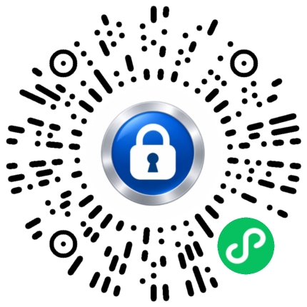

<div align="center">


# 双因子密码验证器

**本地优先的 TOTP / HOTP 多因素认证小程序 · 加密云同步（可选端到端） · 二维码换机迁移**


[同步与迁移](docs/同步与迁移.md) · [交互与动效](docs/交互与动效.md) · [小程序文案](docs/小程序文案.md) · [后端说明](server/README.md)

</div>

---

## 目录

- [特性](#特性)
- [快速开始](#快速开始)
- [安全模型](#安全模型)
- [密钥与部署配置](docs/密钥与部署配置.md)
- [目录结构](#目录结构)
- [测试与守卫](#测试与守卫)
- [部署](#部署)
- [隐私与合规](#隐私与合规)
- [已知局限](#已知局限)
- [更新日志](#更新日志)
- [许可证](#许可证)

---

## 特性

| 分类 | 能力 |
|---|---|
| **算法** | TOTP / HOTP（RFC 6238 / RFC 4226），SHA1 / SHA256，6 位与 8 位，30 / 60 秒周期 |
| **导入** | 扫码导入标准 `otpauth://` 二维码；手动输入 Base32 密钥；参数分基础 / 高级两层 |
| **列表** | 分页加载（每页 20）、下拉刷新、固定头部、**左右滑动切换分组** |
| **展示** | 环形倒计时、到期翻牌、剩余 ≤5 秒呼吸提醒、小字预读「下一码」 |
| **组织** | 分组管理，**拖拽悬浮排序**（跟手 + 震动反馈），箭头微调，即时生效无需保存 |
| **同步** | 免口令，身份 = 微信 openid；退出小程序自动同步 + 手动同步 |
| **换机** | 迁移二维码（一次性令牌，5 分钟有效），新微信扫码接收全部账号 |
| **回收站** | 软删除，按「今天 / 近 7 天 / 近 30 天 / 自定义日期」找回，或彻底删除 |
| **身份** | 点击授权微信头像与昵称（`chooseAvatar` + `input type="nickname"`），只读不可手填 |
| **导出** | 本地导出 JSON 与 otpauth 链接 |

> **无第三方 UI 依赖**：全部图标由 CSS / SVG 遮罩绘制，动画只用 `transform` + `opacity`。

## 快速开始

### 1. 小程序

```bash
cd app
npm install          # 仅一个运行时依赖：crypto-js
```

微信开发者工具导入 `app/` → 菜单 **工具 → 构建 npm** → 编译。

> `构建 npm` 是**必需步骤**，否则 `require('crypto-js')` 失败，云同步会显示「未就绪」。

### 2. 后端（可选，用于云同步与迁移）

`server/` 是云托管部署包（Express + MySQL），部署后把环境信息填到 `app/utils/cloud-sync.js`：

```js
var ENV = '你的云开发环境 ID';
var SERVICE = '你的云托管服务名';
```

不部署后端也能用——验证码生成、分组、回收站、导出全部在本地完成。

## 安全模型

### 密钥层级（免口令）

```
首次使用：随机 32 字节 DEK（wx.getRandomValues）→ 存本机
保险库：  AES-256-CBC(DEK) + HMAC-SHA256 → 密文
换机（默认）：KEK = HMAC-SHA256(VAULT_SECRET, openid) → 解开包裹的 DEK
换机（口令）：KEK = PBKDF2(用户口令, salt) → 解开包裹的 DEK
换机（迁移）：迁移二维码携带 DEK（一次性令牌，5 分钟）
```

- 服务端只保存**密文字符串**，不做任何解密
- 数据库被单独拖走拿不到 TOTP 种子——`VAULT_SECRET` 不在库里
- 但云平台 / 持有 `VAULT_SECRET` 者可推导 KEK 解密，因此默认模式**不是端到端**
- 需要真端到端时改用口令包裹（设置 → 端到端加密）
- 数据按 `openid` 分行隔离；迁移令牌一次性使用

三条恢复路径：

| 方式 | 依赖 | 场景 |
|---|---|---|
| 零配置自动恢复 | `VAULT_SECRET` + openid | 换机/重装，零输入 |
| 口令解锁 | 用户口令 | 服务端不可解密（端到端） |
| 应急恢复码 | 用户保存的 52 位字符 | 前两者失效时兜底 |

> 密钥配置的完整步骤、验证命令与故障排查见
> **[docs/密钥与部署配置.md](docs/密钥与部署配置.md)**。

### 数据流

```
┌──────────────┐   密文 HTTPS    ┌──────────────┐        ┌──────────┐
│ 小程序（设备）│ ──────────────▶ │ 云托管后端    │ ─────▶ │  MySQL   │
│ DEK → AES-256│ ◀────────────── │ 只存 data 字段│ ◀───── │ vault 表 │
└──────────────┘                 └──────────────┘        └──────────┘
        │
        │ 迁移二维码（含 DEK + 一次性 token）
        ▼
┌──────────────┐
│ 小程序（新机）│  扫码 → 领取密文 → 用 DEK 解密 → 写入本机
└──────────────┘
```

**取舍**：免口令换来开箱即用，代价是 DEK 存在本机——设备被解锁状态下他人可解密。
如需更强防护，可在 DEK 外再包一层设备生物识别（`wx.startSDeviceCredential`）。

详见 [docs/同步与迁移.md](docs/同步与迁移.md)。

## 目录结构

```
app/                        微信小程序（原生）
├── app.js / app.json / app.wxss    全局：cloud.init、onHide 自动同步、设计 token、ICON 库
├── assets/logo.png                 关于页图标（96px）
├── components/
│   ├── otp-card/                   验证码卡片（环形倒计时、翻牌、下一码）
│   ├── action-sheet/               账号操作菜单（替代 showActionSheet）
│   ├── select-sheet/               通用选择器（替代 picker）
│   ├── date-sheet/                 日期选择（替代 picker mode="date"）
│   └── loading/                    加载遮罩
├── pages/
│   ├── index/     首页：分页、下拉刷新、滑动切分组、FAB
│   ├── input/     添加/编辑账号（基础 + 高级折叠）
│   ├── groups/    分组管理（拖拽悬浮排序）
│   ├── recycle/   回收站（日期范围筛选）
│   ├── settings/  设置（同步、迁移、身份、关于）
│   └── export/    导出备份
└── utils/
    ├── totp.js        SHA1/SHA256 + HMAC + Base32 + HOTP/TOTP（纯 JS）
    ├── otpauth.js     otpauth:// 解析与生成
    ├── store.js       本地存储（软删除 / 回收站 / 分组 / 身份）
    ├── crypto.js      AES-256-CBC + HMAC（随机数走 wx.getRandomValues）
    ├── vault.js       免口令密钥（DEK）与保险库
    ├── sync.js        同步编排（push / pull）
    ├── cloud-sync.js  云托管接口封装
    └── util.js        时间格式化、导航栏度量

server/                     云同步后端（Express + MySQL + qrcode）
docs/                       设计文档、文案、图片资源
```

## 测试与守卫

全部离线可跑（Node 环境，无需开发者工具）：

```bash
# 功能测试（13 套 / 266 项断言）
node tools/test_ui_totp.js          # SHA1/SHA256/HMAC/Base32 + RFC 官方向量（21）
node tools/test_app_logic.js        # 数据层 CRUD / 分组 / 迁移（35）
node tools/test_crypto.js           # 加解密往返 / 篡改拒绝（12）
node tools/test_vault_local.js      # 免口令密钥链路 / 身份随库同步（17）
node tools/test_recycle.js          # 回收站：软删除 / 日期筛选 / 彻底删除（30）
node tools/test_pagination.js       # 分页：切片 / 触底边界 / 空列表（13）
node tools/test_nextcode.js         # 下一码：算法等价 / 隐藏态不产出（15）
node tools/test_auth_prompt.js      # 授权：点击才弹 / 已授权不弹（12）
node tools/test_input_advanced.js   # 输入页：高级折叠 / 摘要 / 自动展开（20）
node tools/test_ui_sheets.js        # 自定义浮层：日期 / 开关 / 菜单 / 关于（24）
node tools/test_groups_drag.js      # 分组拖拽：悬浮跟手 / 越界（19）
node tools/test_clear_all.js        # 清空全部：二次确认 / 取消无副作用（24）
node tools/test_swipe_groups.js     # 滑动切分组：阈值 / 边界 / 动画方向（24）

# 静态守卫（改样式必跑）
node tools/check_ui.js              # JSON / 页面文件 / require / 事件绑定
node tools/check_styles.js          # wxml class 是否都有样式定义
node tools/check_css_traps.js       # fixed 定位陷阱 / 花括号结构 / 弹窗居中冲突
node tools/check_fixed_nav.js       # 所有页面导航固定 + 滚动容器约束
node tools/check_modal_text.js      # showModal 按钮文案 ≤4 字（超长会静默失败）

# 集成测试（需要后端在线）
node tools/test_e2e_sync.js         # 上传 → 下载 → 解密还原（15）
node tools/test_migrate_e2e.js      # 迁移令牌：一次性 / 过期 / 同账号拒绝（12）
```

守卫解决的都是一次真实踩过的坑，例如：

- `wx.showModal` 的 `confirmText` 超过 4 字会**静默失败**，按钮点了没反应
- 页面根节点加 `transform` 会让 `position: fixed` 的子元素改为相对它定位，浮层全部错位
- `scroll-view` 缺 `min-height: 0` 会撑破 flex 容器，导致页面整体滚动、导航跟着滚走

## 部署

### 后端到微信云托管

1. 新建云托管服务，代码来源选本仓库（`main` 用根 `Dockerfile`，或直接用 `backend` 分支）
2. 关联云数据库 MySQL，环境变量由平台注入（`MYSQL_ADDRESS` / `MYSQL_USERNAME` / `MYSQL_PASSWORD`）
3. **手动添加 `VAULT_SECRET`**（32 位以上随机串，见下方说明）——不加则零配置恢复不可用
4. 表结构在启动时自动创建（`vault`、`vault_history`、`migrate_token`、`profile`）
5. 网关会自动注入 `X-WX-OPENID`，无需自建登录

> **`VAULT_SECRET` 必须异地备份且设定后不可更改**。它是零配置恢复的唯一凭据：
> `KEK = HMAC-SHA256(VAULT_SECRET, openid)`，改了 KEK 就变了，历史密文永久解不开。
> 生成方式：`"saigou-" + (($b | ForEach-Object { $_.ToString('x2') }) -join '')`（详见配置文档）。
> **不要用公开信息**（GitHub ID、昵称、手机号）——它们是公开的，等于没有密钥。

接口：

| 方法 | 路径 | 说明 |
|---|---|---|
| GET | `/api/health` | 健康检查 |
| POST | `/api/vault` | 上传密文（内容变化时自动存档一版） |
| GET | `/api/vault` | 下载密文 |
| GET | `/api/vault/history` | 版本列表（最近 20 版） |
| GET | `/api/vault/history/:id` | 取指定版本密文 |
| POST | `/api/vault/restore` | 恢复到指定版本 |
| GET | `/api/wrap-key` | 取客户端 KEK（需 `VAULT_SECRET`） |
| POST | `/api/migrate/issue` | 生成迁移令牌 + 二维码 |
| POST | `/api/migrate/claim` | 新账号领取密文 |

> MySQL 若开启「自动暂停」，闲置后首次请求需 10–20 秒唤醒。

## 隐私与合规

- **收集**：微信 openid（身份识别）、用户主动选择的头像昵称、用户录入的验证码密钥
- **不收集**：位置、通讯录、相册、麦克风、设备信息、剪贴板
- **第三方共享**：无
- **存储**：本机 + 开发者自有云托管（仅密文）

发布前需在微信公众平台填写「用户隐私保护指引」，对照表见 [docs/小程序文案.md](docs/小程序文案.md)。

## 已知局限

| 项 | 说明 |
|---|---|
| 设备时钟 | TOTP 依赖本地时间，偏差会导致验证码错误；应用内已提示开启自动对时 |
| 默认非端到端 | 零配置模式由服务端 KEK 托管密钥，云平台可解密；需端到端请启用口令 |
| 免口令的代价 | DEK 存在本机，未做设备生物识别包裹 |
| 单端权威 | 多设备同时修改时以最后上传为准，未做冲突合并（`rev` 字段已预留） |
| 云端不删 | 「彻底删除」目前只清本地，云端密文仍保留，需要时得加 `DELETE /api/vault` |
| 无暗色模式 | 仅提供亮色主题 |

## 更新日志

### 1.3.6
- **修复严重缺陷**：启用口令时 `wrapDekWithPassword` 误用了 `crypto.createVault()`，
  它会**新生成一个随机 DEK** 去包裹，而不是包裹当前 DEK。结果口令解锁得到的是另一把钥匙，
  原有密文解不开（表现为「换机后数据为空」）。已改为包裹当前 DEK。
- **影响范围**：仅影响曾在 1.3.5 及更早版本启用过口令的账号。本机数据未损坏
  （body 一直由原 DEK 加密），但云端 header 里存的是错误密钥。
  升级后重新执行一次「启用口令」即可修复，或用本机 DEK / 恢复码先解锁。
- 新增断言：口令解锁必须返回与原 DEK 完全相同的密钥，并能解开原有密文（test_sync_guard 43 条）

### 1.3.5
- **密钥模式可互相切换**：口令模式下方新增「切回零配置恢复」，
  清了 header 重新 push 即自动用服务端 KEK 重包；切换失败会还原，不会卡在中间态
- 口令浮层显示当前模式（口令模式 / 零配置模式）

### 1.3.4
- **云端版本历史**：每次同步内容有变化就存档一版，保留最近 20 版；
  设置页可查看时间/大小并恢复到指定版本
- 恢复是**可逆的**：恢复旧版本不会销毁当前数据，它会作为新的一版继续留存在历史里
- 新增接口：`GET /api/vault/history`、`GET /api/vault/history/:id`、`POST /api/vault/restore`
- 新表 `vault_history`（openid + created_at 索引，自动裁剪至 20 条）

### 1.3.3
- **零配置密钥找回**：新增 `GET /api/wrap-key`，`KEK = HMAC-SHA256(VAULT_SECRET, openid)`；
  首次同步会用 KEK 包裹 DEK 一并上传，换设备/重装无需任何输入即可自动恢复
- **加密模型说明**：该模式下服务端可推导 KEK 解密数据（非端到端），但数据库单独泄露
  不足以解密（还缺 `VAULT_SECRET`）；需要真端到端可在设置里改用口令包裹
- **覆盖保护修复**：移除首次启动植入示例账号；推送前先探测云端，本地为空 / 无密钥 /
  密钥不匹配一律拒绝，避免重装后覆盖云端数据
- **启动自动恢复**：本机为空且云端有数据时自动拉取，失败时明确提示需要密钥

> **VAULT_SECRET 的强度要求**：KEK 的安全性完全取决于这个值。建议 32 位以上随机串，
> 不要用短词或字典词——拖库者可直接用词表还原 KEK，等同于没有加密。
> 服务端启动时会对短于 16 位的值打印告警。设定后不可更改，否则旧数据无法解开。

### 1.3.2
- **移除头像昵称功能**：微信 `chooseAvatar` / `input type="nickname"` 在部分环境（尤其开发者工具）
  无回调且不报错，无法保证可用，故整体移除；首页与设置页不再显示身份
- 同步状态改为不依赖身份数据

### 1.3.1
- **身份资料云端备份**：新增 `profile` 表与 `/api/profile` 接口，昵称头像明文存云端，
  删除小程序/重装后自动拉回
- **密钥可恢复**：新增「恢复码」（DEK 的 Base32 备份）与「云端密钥备份」
  （口令包裹 DEK 后上传，服务端无口令解不开）
- **覆盖保护**：本机重新生成密钥且云端已有密文时拒绝上传，避免永久覆盖旧数据
- **头像改用对象存储**：优先 `wx.cloud.uploadFile` 存 `cloud://` fileID，
  失败退回 base64
- **授权弹层修复**：`wx:if` 挂载避免状态残留；已授权也能重新选择；
  `canIUse` 检测不支持时退化为普通输入

### 1.3.0
- 更名「双因子密码验证器」，导航与关于页同步
- 首页支持左右滑动切换分组
- 所有页面导航固定、内容内部滚动
- 清空全部改为二次确认（修复按钮文案超 4 字导致的弹窗静默失败）
- 采用新 Logo，关于页展示

### 1.2.0
- 回收站：软删除 + 按删除日期范围找回
- 分页加载、下拉刷新、统一动效令牌
- 全局图标改为 SVG 遮罩系统

### 1.1.0
- 免口令云同步（身份 = 微信 openid），退出自动同步
- 二维码换机迁移
- 移除口令体系与「测试连接」

### 1.0.0
- TOTP / HOTP 引擎、分组、扫码导入、导出备份

## 小程序码

<div align="center">



用微信「扫一扫」打开

</div>

## 许可证

本项目采用 [MIT License](LICENSE) 发布。

```
MIT License · Copyright (c) 2026 saiGou-14H
```

你可以自由使用、修改、分发，包括商业用途，只需保留版权声明与许可声明。

第三方依赖同样为 MIT：`crypto-js`（小程序）、`express` / `mysql2` / `qrcode`（后端）。

> 商标说明：文档中出现的 Google Authenticator、Microsoft Authenticator 等名称仅用于说明
> 兼容性，商标归各自所有者，与本项目无关联、无背书关系。
